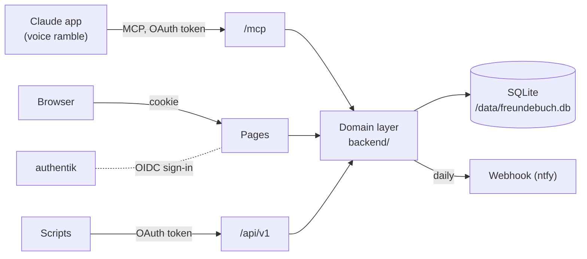

# How it works

freundebuch is one Next.js app with a SQLite database. There is no sidecar: the MCP endpoint, the REST API and the web pages all call the same framework-free domain layer in `backend/`.

The domain returns plain data. Over MCP and in the in-app chat, the tool layer (`backend/mcp/tools.ts`) adds `next` to every result: what Claude should do now, worked out from what the call did ([ADR 0010](../adr/0010-tool-results-tell-claude-what-to-do-next.md)).

## Sign-in

- **Pages** use a sign-in cookie set after the authentik (OIDC) sign-in.
- **Claude** connects through freundebuch's own OAuth server: dynamic client registration, PKCE, and the authorize step is that same authentik sign-in.
- Tokens are stateless HMAC-signed values tied to one surface: an MCP token doesn't work on REST, a REST token doesn't work on MCP, and the browser cookie never works on MCP.

## Books and the data layer

Everything about people lives in a book: its persons, conversations, rambles, items, groups, places and files carry the book's id, and every reference between them names the book too, so nothing can point into another book. A user is a member of a book and a person in it ("me"); the book's members are "us". Users themselves, their settings, their own cards and chat usage are outside books.

Only `backend/db` talks to the database. The domain gets a scope from the session (`scope(v)`), which narrows every query to the viewer's books and puts every new row in their book; instance tables go through `instance()`. Lint keeps Kysely out of the rest of the backend, and in tests every query on a book table that doesn't name its book fails ([ADR 0025](../adr/0025-books-in-one-scoped-database.md)). The database is opened and migrated when the server starts; if that fails, the server doesn't start.

## Privacy

Inside a book, every row a person can see is either shared or recorded by them. That single rule is one function in the query layer, and every read path goes through it, including counts, hints, the graph and notifications. [ADR 0002](../adr/0002-privacy-model.md) explains the details.

## Notifications

A timer in the server process checks once per minute whether it's past `FREUNDEBUCH_NOTIFY_AT`. Then it sends each person their own due list to their webhook. Progress is tracked per person, so one broken webhook doesn't block or repeat anyone else's reminders.

## Design decisions

- [AI-first app with a built-in MCP](../adr/0001-ai-first-app-with-built-in-mcp.md)
- [Privacy model](../adr/0002-privacy-model.md)
- [authentik sign-in and own OAuth server](../adr/0003-authentik-sign-in-and-own-oauth-server.md)
