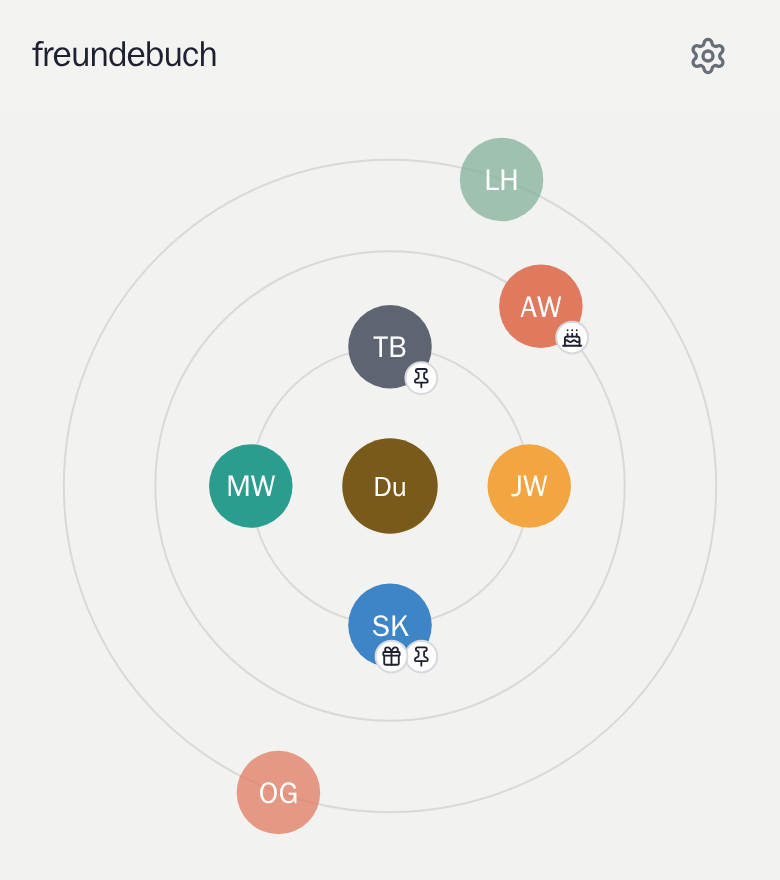
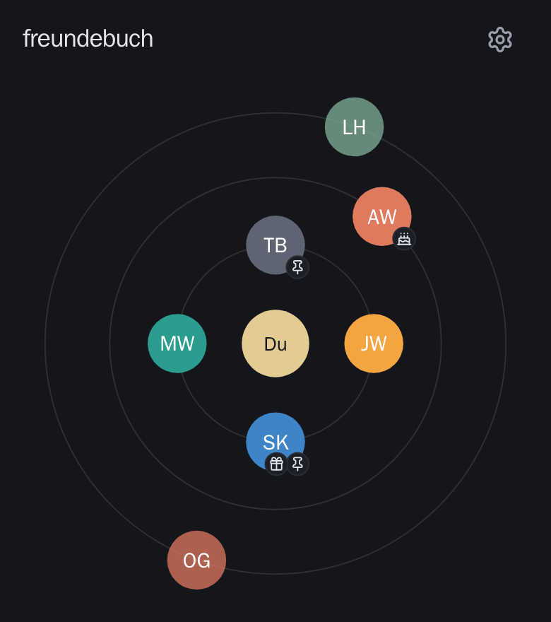
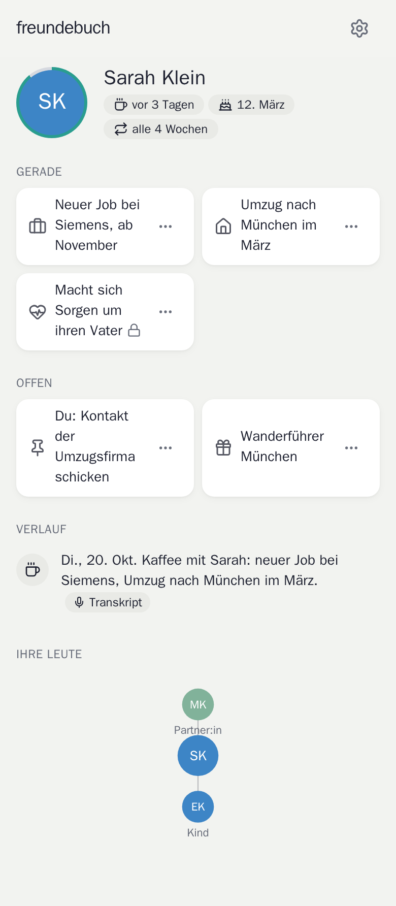

# The web app

The web app is in German, made for a quick look on the phone before you meet someone. It has three views.

## Orbit (start page)

You're in the middle ("Du"). Everyone you know sits on one of three rings: the inner ring for people you saw recently, the outer ring for people you're due to see. Small badges show what's waiting:

- 🎂 a birthday coming up,
- 📌 an open promise,
- 🎁 a gift idea.

Tap a face to open the person.

## A friend's page

From top to bottom:

- when you last saw them, their check-in interval, their birthday and their groups,
- **Gerade**: what's new, as current facts,
- **Offen**: open promises, gift ideas and other exchanges, with quick actions,
- **Verlauf**: the conversations, newest first. Each one opens its summary and, if it's visible to you, its transcript,
- **Ihre Leute**: a small graph of the people around them.

Private items have a lock icon. Only you see them.

## Settings

The gear icon opens **Einstellungen**: your webhook for [notifications](notifications.md), and signing out.
